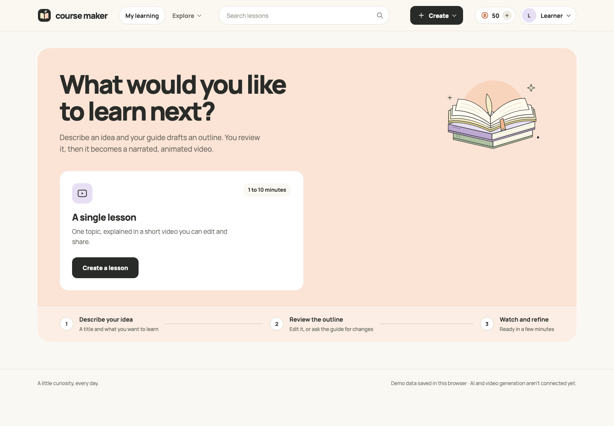
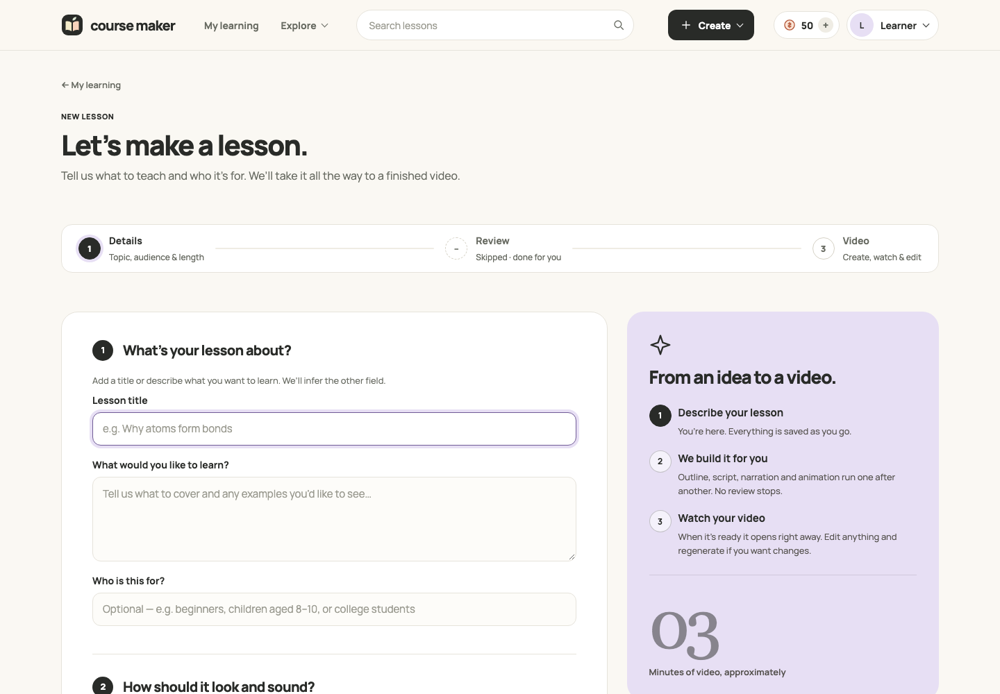
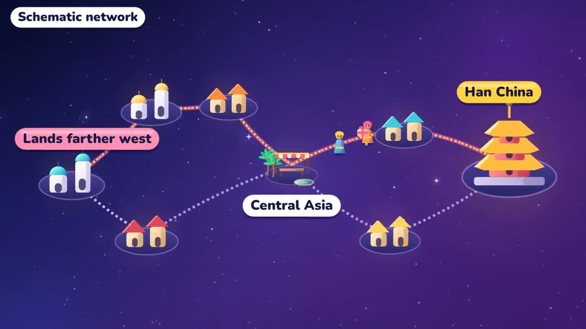

# Course Maker

**Turn a learning goal into a narrated, animated lesson.**

Course Maker is a self-hostable learning and course creation app. Describe a topic and audience, refine an AI-generated outline, and produce a lesson with narration, synchronized illustrations, quizzes, and interactive exercises. It also includes a course and syllabus workflow for organizing longer learning paths.

[MIT license](LICENSE) · [Quick start](#quick-start) · [Example videos](#example-videos) · [Architecture](#architecture) · [Contributing](CONTRIBUTING.md)



## What it does

- **Create from a brief.** Set a topic, audience, duration, visual style, and quality preference.
- **Refine the teaching plan.** Review outlines and use conversational guides to adjust lesson content and scripts.
- **Make narrated videos.** Generate speech, align animation to narration, render an MP4, and optionally request AI visual review and a bounded repair.
- **Choose an illustration style.** Eleven packaged styles include Flat-Vector Science, Bauhaus, watercolor, whiteboard, and more.
- **Add practice.** Create lesson quizzes and interactive learning activities.
- **Learn and share.** Browse lessons, manage a library, track learning activity, and expose finished work on creator profiles.
- **Run your own instance.** Optional account authentication, Google sign-in, email flows, and Stripe credit billing are included.

This is an early-stage project. Generated explanations and visuals need human review before being used for teaching. The default interface focuses on standalone lessons; course creation is available behind the existing course feature flag.

## Screenshots

Screenshots below use a fresh local demo session. They contain no production account or learner data.

### Lesson creation



### Example lesson frames

| Silk Roads | Chemical bonding |
| --- | --- |
| [](https://github.com/mcontre4/course-maker-open-source/raw/refs/heads/main/docs/media/silk-roads.mp4) | [](https://github.com/mcontre4/course-maker-open-source/raw/refs/heads/main/docs/media/chemical-bonding.mp4) |

## Example videos

These are real Course Maker outputs retrieved from local render artifacts, compressed for this repository with narration preserved and container metadata stripped. Click a preview above or download an MP4:

- [How the Silk Roads connected cultures — 1:05](https://github.com/mcontre4/course-maker-open-source/raw/refs/heads/main/docs/media/silk-roads.mp4)
- [Why atoms bond: energy and stability — 1:47](https://github.com/mcontre4/course-maker-open-source/raw/refs/heads/main/docs/media/chemical-bonding.mp4)

Both examples are included in [docs/media](docs/media), so they remain available when you clone the repository. See the [media notes](docs/media/README.md) for provenance and the chemistry reference.

## Quick start

### Explore the interface without API keys

Install Node.js 24 or later, then run:

```sh
git clone https://github.com/mcontre4/course-maker-open-source.git
cd course-maker-open-source/frontend
npm ci
VITE_DEMO_MODE=true npm run dev
```

Open the local address printed by Vite, normally `http://localhost:5173`. Demo mode stores sample data in your browser. Live AI generation, speech, and video rendering require the backend and your own provider credentials.

### Run the backend and video pipeline

You will need Python 3.12+, Poetry 2, Node.js, and a running Docker engine with Docker Compose. The local Compose setup uses **MySQL 8.4 and Redis**; the backend also has PostgreSQL support and PostgreSQL integration coverage.

From the repository root:

```sh
cp backend/.env.example backend/.env
python3 - <<'PY'
from pathlib import Path
import secrets
path = Path("backend/.env")
path.write_text(path.read_text().replace(
    "COURSE_MAKER_API_KEY=\n",
    "COURSE_MAKER_API_KEY=" + secrets.token_urlsafe(32) + "\n",
    1,
))
PY
npm ci --prefix frontend
```

Fill in the provider values you need in `backend/.env`:

| Variable | Purpose |
| --- | --- |
| `COURSE_MAKER_OPENROUTER_API_KEY` | AI lesson planning, scripting, animation, and guides |
| `COURSE_MAKER_TAVILY_API_KEY` | Research for syllabus and lesson creation |
| `COURSE_MAKER_ELEVENLABS_API_KEY` | Narration and speech alignment |
| `COURSE_MAKER_ELEVENLABS_VOICE_ID` | A voice available to your ElevenLabs account |

Then start the full local stack:

```sh
sh scripts/dev-main.sh
```

The script builds the local animator and renderer images, applies migrations, starts the API at `http://127.0.0.1:50050`, and starts the UI at `http://localhost:5173`. The development override mounts the Docker socket and is intended for a trusted local machine. Provider requests may incur charges on your accounts.

For a backend without the local rendering override:

```sh
docker compose --env-file backend/.env up -d --build api
cd frontend
npm run dev
```

The base API runs at `http://127.0.0.1:8000`; its interactive API documentation is at `/docs`. Full local video production uses `scripts/dev-main.sh`. Account authentication is opt-in; read [authentication setup](docs/authentication.md) before exposing an instance to other people. The bundled database passwords are local development defaults.

### Optional services

Google Cloud Storage can store assets; Google OAuth and SMTP support account flows; Stripe supports credit purchases. None of these credentials are included. See [authentication](docs/authentication.md), [credits](docs/credits.md), and [animator setup](docs/animator-agent.md) for configuration.

## Architecture

The backend follows hexagonal architecture with independent domains and explicit ports:

```text
frontend/           React 19, TypeScript, Vite, TanStack Query
backend/
  src/app/
    <domain>/
      domain/       Pure business models and rules
      ports/        Repository and external-service interfaces
      application/  One use case per service, explicit request/response DTOs
      adapters/     HTTP, SQLAlchemy, Redis, AI, and media implementations
  migrations/       Alembic schema migrations
  tests/            Unit, integration, contract, and browser fixtures
tools/animator/     Canvas animation, rendering workers, styles, legacy toolkit
infra/terraform/    Google Cloud asset-storage infrastructure
```

Dependencies point inward: `adapters → application → domain`. Pydantic AI powers teaching agents; animation and visual review use direct model calls. SQLAlchemy handles persistence. Redis handles transient coordination and caching. New lesson animation uses JavaScript and Canvas; the repository also retains legacy Remotion/Rive tooling.

## Development

```sh
poetry -C backend install --extras ai
python3 backend/scripts/check_hexagonal_boundaries.py --root backend/src
poetry -C backend run tach check
poetry -C backend run ruff check src tests
poetry -C backend run mypy
poetry -C backend run pytest tests/unit
npm --prefix frontend run build
npm --prefix frontend test
```

Integration tests require Docker and create disposable infrastructure. Live-provider smoke tests are opt-in and can cost money. See [backend notes](backend/README.md), [frontend notes](frontend/README.md), and [contributing](CONTRIBUTING.md).

Useful deeper references:

- [Generation stages](docs/course-generation-pipeline.md)
- [Canvas video production and verification](docs/canvas-video-production.md)
- [Syllabus agent](docs/syllabus-agent.md)
- [Lesson Creator](docs/lesson-creator-agent.md)
- [Narration and alignment](docs/tts-alignment.md)
- [Lesson styles](docs/lesson-style.md)
- [AI spend tracking](docs/ai-spend.md)

## Security and public distribution

This repository starts from a sanitized source snapshot with fresh Git history. Private environment files, credentials, databases, raw generation logs, editor state, and production account data are excluded. Only selected documentation media is bundled.

Gitleaks runs on pushes and pull requests. Its configuration allows only exact, nonfunctional test fixture strings; test directories remain scanned. Keep credentials in ignored environment files, never in browser-exposed `VITE_*` variables. See [SECURITY.md](SECURITY.md) for reporting and release hygiene.

## License

Course Maker's original code and documentation are available under the [MIT license](LICENSE). Bundled third-party code and fonts retain their own notices. Dependencies, including the legacy Remotion toolkit, have separate licensing terms; see [third-party notices](THIRD_PARTY_NOTICES.md).
